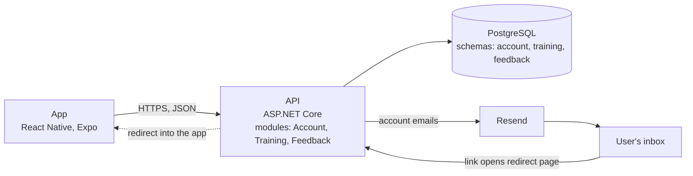

## Parts

- **App:** the phone app. It talks only to the API. See [Frontend architecture](/architecture/frontend).
- **API:** one process with three modules, `Account`, `Training` and `Feedback`. It also runs background jobs. See [Backend architecture](/architecture/backend).
- **PostgreSQL:** one database, one schema per module.
- **Resend:** sends email. Locally, Mailpit takes its place. See [Configuration](/development/configuration).

## Email links

Links in email open the app through a redirect page.

1. The email links to an HTTPS page served by the API, for example `/links/reset-password?token=…`.
2. The page redirects into the app, using `AppUrl` from [Configuration](/development/configuration#api-settings). A built app has its own link scheme. Expo Go only opens `exp://` links, so locally `AppUrl` is the Expo Go address.
3. The app opens the matching screen, for example A12 for a password reset, or A10 when the link has expired.

This works in Expo Go and in a built app. The page changes nothing when it opens, because email apps open links to check them.
