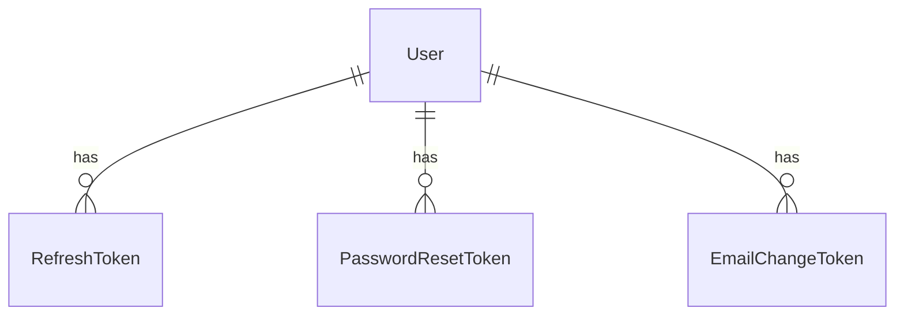
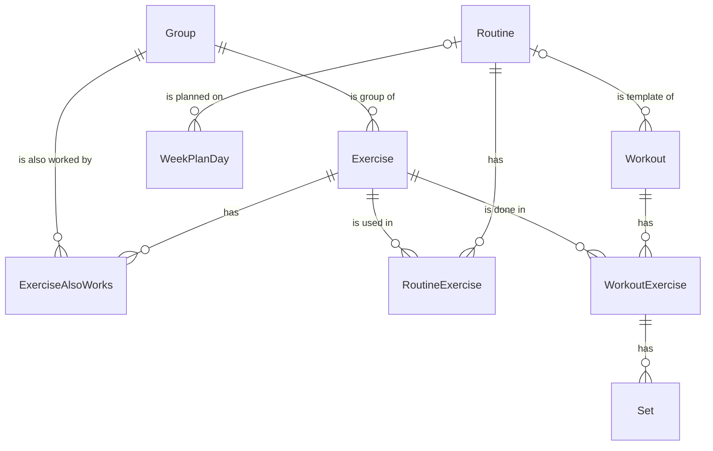

Terms and rules are in [Domain and entities](/product/domain). Database naming is in [Conventions](/development/conventions#naming).

## Common properties

Every entity has these.

| Property | Type | Notes |
|---|---|---|
| Id | typed ID, for example `ExerciseId` | Wraps a UUID v7 |
| CreatedAtUtc | DateTimeOffset | |
| UpdatedAtUtc | DateTimeOffset | |

Properties ending in `Utc` are points in time in UTC. `DateOnly` properties are dates in the user's time zone.

## Account

### User

| Property | Type | Notes |
|---|---|---|
| Email | string | Unique, case-insensitive |
| PasswordHash | string | |
| Name | string? | Empty until setup (A30) |
| Photo | byte[]? | |
| PhotoContentType | string? | |
| TimeZone | string | IANA name, for example `Europe/Zagreb` |
| Theme | enum | `MatchPhone`, `Dark`, `Light`. Starts at `MatchPhone` |
| Color | enum | `RacingBlue`, `Titanium`. Starts at `RacingBlue` |
| Units | enum | `Metric`, `Imperial`. Starts at `Metric` |
| RefreshTokens | list of RefreshToken | |
| PasswordResetTokens | list of PasswordResetToken | |
| EmailChangeTokens | list of EmailChangeToken | |

### RefreshToken

| Property | Type | Notes |
|---|---|---|
| UserId | UserId | → User |
| User | User | |
| TokenHash | string | |
| ExpiresAtUtc | DateTimeOffset | |

### PasswordResetToken

| Property | Type | Notes |
|---|---|---|
| UserId | UserId | → User |
| User | User | |
| TokenHash | string | |
| ExpiresAtUtc | DateTimeOffset | |

### EmailChangeToken

| Property | Type | Notes |
|---|---|---|
| UserId | UserId | → User |
| User | User | |
| NewEmail | string | |
| TokenHash | string | |
| ExpiresAtUtc | DateTimeOffset | |

## Training

Every Training entity has a `UserId` (type `UserId`). It has no foreign key to the Account module.

### WorkoutSettings

| Property | Type | Notes |
|---|---|---|
| UserId | UserId | Unique |
| DefaultRestSeconds | int | Starts at 180 (3:00) |
| RestSound | bool | Starts on |
| RestVibrate | bool | Starts on |

### Group

| Property | Type | Notes |
|---|---|---|
| UserId | UserId | |
| Name | string | |
| NormalizedName | string | Unique per user among groups that are not deleted |
| Order | int | |
| DeletedAtUtc | DateTimeOffset? | |
| Exercises | list of Exercise | |

### Exercise

| Property | Type | Notes |
|---|---|---|
| UserId | UserId | |
| Name | string | Up to 100 characters |
| NormalizedName | string | Trimmed and lowercase. Unique per user among exercises that are not deleted |
| GroupId | GroupId | → Group |
| Group | Group | |
| AlsoWorks | list of ExerciseAlsoWorks | |
| DeletedAtUtc | DateTimeOffset? | |

### ExerciseAlsoWorks

| Property | Type | Notes |
|---|---|---|
| UserId | UserId | |
| ExerciseId | ExerciseId | → Exercise |
| GroupId | GroupId | → Group. Unique together with ExerciseId |
| Group | Group | |

### Routine

| Property | Type | Notes |
|---|---|---|
| UserId | UserId | |
| Name | string | |
| NormalizedName | string | Unique per user among routines that are not deleted |
| DeletedAtUtc | DateTimeOffset? | |
| Exercises | list of RoutineExercise | |

### RoutineExercise

| Property | Type | Notes |
|---|---|---|
| UserId | UserId | |
| RoutineId | RoutineId | → Routine |
| ExerciseId | ExerciseId | → Exercise. Unique together with RoutineId |
| Exercise | Exercise | |
| Order | int | |
| TargetSets | int | Starts at 3 |
| TargetRepsFrom | int | Starts at 8 |
| TargetRepsTo | int | Starts at 10 |

### WeekPlanDay

| Property | Type | Notes |
|---|---|---|
| UserId | UserId | |
| Weekday | enum | `Monday` to `Sunday` |
| RoutineId | RoutineId? | → Routine. Empty means rest day |
| Routine | Routine? | |
| EffectiveFrom | DateOnly | Unique per user together with Weekday |

### Workout

| Property | Type | Notes |
|---|---|---|
| UserId | UserId | |
| Date | DateOnly | Unique per user among workouts that are not deleted |
| Name | string | |
| Status | enum | `InProgress`, `Completed`, `Skipped` |
| RoutineId | RoutineId? | → Routine |
| Routine | Routine? | |
| StartedAtUtc | DateTimeOffset? | Empty when skipped, and on a past day |
| FinishedAtUtc | DateTimeOffset? | Empty while in progress and when skipped |
| DeletedAtUtc | DateTimeOffset? | |
| Exercises | list of WorkoutExercise | |

### WorkoutExercise

| Property | Type | Notes |
|---|---|---|
| WorkoutId | WorkoutId | → Workout |
| ExerciseId | ExerciseId | → Exercise |
| Exercise | Exercise | |
| Order | int | |
| TargetSets | int | Copied from the routine |
| TargetRepsFrom | int | Copied from the routine |
| TargetRepsTo | int | Copied from the routine |
| Sets | list of Set | |

### Set

| Property | Type | Notes |
|---|---|---|
| WorkoutExerciseId | WorkoutExerciseId | → WorkoutExercise |
| Order | int | Shown as the set number |
| WeightKg | decimal(6,2) | |
| Reps | int | |
| Checked | bool | |
| WeightChanged | bool | Changed by hand, so a change on an earlier set leaves it alone |
| RepsChanged | bool | Changed by hand, so a change on an earlier set leaves them alone |
